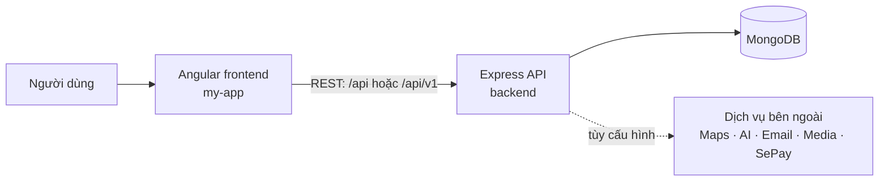
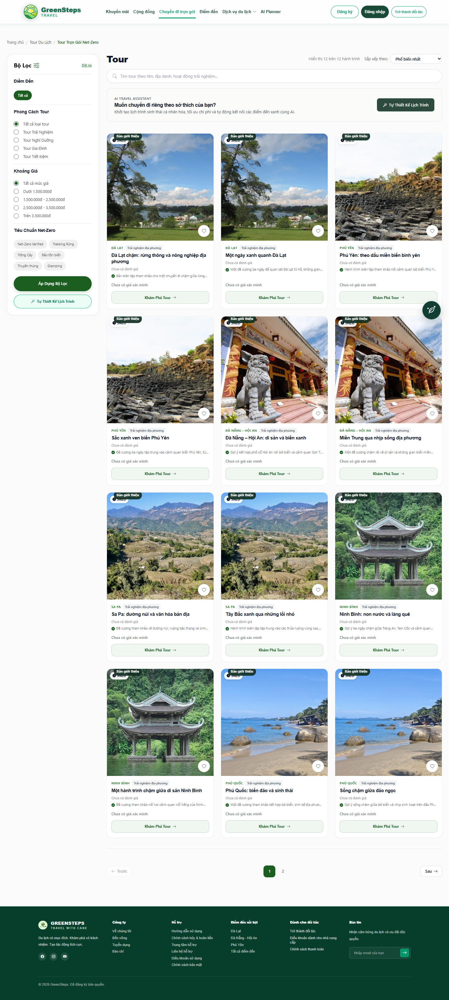
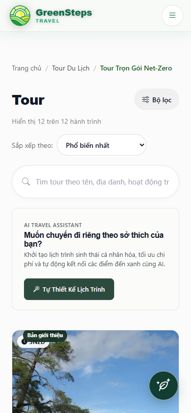

# GreenSteps Travel

**GreenSteps Travel** là website du lịch sinh thái được xây dựng nhằm giúp du khách khám phá điểm đến, tìm kiếm dịch vụ, lên kế hoạch và đặt chỗ cho chuyến đi tại Việt Nam. Hệ thống kết nối khách hàng với các nhà cung cấp dịch vụ du lịch, đồng thời hỗ trợ quản lý hoạt động trên cùng một nền tảng. Đây là đồ án cuối kỳ môn **Phát triển Web Kinh doanh Nâng cao** của Nhóm 15, với định hướng khuyến khích những lựa chọn du lịch có trách nhiệm với môi trường và cộng đồng địa phương.

- **Học phần:** Phát triển Web Kinh doanh Nâng cao
- **Mã học phần:** 261BIE503103
- **Nhóm:** Nhóm 15
- **Loại dự án:** Đồ án cuối kỳ

## Mục lục

- [Chức năng chính](#chức-năng-chính)
- [Công nghệ sử dụng](#công-nghệ-sử-dụng)
- [Kiến trúc hệ thống](#kiến-trúc-hệ-thống)
- [Cấu trúc thư mục](#cấu-trúc-thư-mục)
- [Hướng dẫn cài đặt và chạy dự án](#hướng-dẫn-cài-đặt-và-chạy-dự-án)
- [Dịch vụ tích hợp](#dịch-vụ-tích-hợp)
- [Website demo và mã nguồn](#website-demo-và-mã-nguồn)
- [Thành viên](#thành-viên)
- [Trạng thái triển khai và giới hạn](#trạng-thái-triển-khai-và-giới-hạn)

## Chức năng chính

### Khách hàng

- Đăng ký tài khoản, xác thực email bằng OTP, đăng nhập và cập nhật thông tin cá nhân.
- Sử dụng Google, Facebook hoặc passkey để đăng nhập khi các phương thức này đã được cấu hình.
- Tìm kiếm và xem thông tin tour, điểm đến, phương tiện di chuyển, nơi lưu trú và dịch vụ ẩm thực địa phương.
- Đặt tour và dịch vụ; theo dõi đơn đặt chỗ, gửi yêu cầu điều chỉnh và xem lại lịch sử đặt chỗ.
- Thanh toán qua ví GreenSteps hoặc SePay khi hệ thống đã được cấu hình đầy đủ.
- Lưu dịch vụ yêu thích, viết đánh giá và chia sẻ trải nghiệm trong cộng đồng.
- Tạo và lưu lịch trình, cùng người khác chỉnh sửa kế hoạch chuyến đi và nhận hỗ trợ từ chatbot du lịch.

### Đối tác

- Đăng ký tài khoản đối tác và đăng tải, quản lý các dịch vụ cung cấp trên nền tảng.
- Theo dõi đơn đặt chỗ, kết quả hoạt động và các chương trình khuyến mãi qua trang quản lý đối tác.
- Cập nhật trạng thái đơn đặt chỗ và phản hồi đánh giá trong phạm vi quyền truy cập.

### Quản trị viên

- Quản lý người dùng, nhà cung cấp, tour, dịch vụ và điểm đến.
- Theo dõi số liệu trên bảng điều khiển, quản lý đơn đặt chỗ và xử lý yêu cầu hoàn tiền.
- Kiểm duyệt bài viết cộng đồng, quản lý chương trình khuyến mãi và thiết lập hệ thống.

**Lưu ý:** Các tính năng liên quan đến thanh toán, email, lưu trữ hình ảnh và AI chỉ hoạt động khi dịch vụ tương ứng được cấu hình. Việc chức năng xuất hiện trong mã nguồn không đồng nghĩa với việc chức năng đó đã được kích hoạt trên mọi môi trường.

## Công nghệ sử dụng

| Thành phần | Công nghệ | Vai trò |
|---|---|---|
| Frontend | Angular 21, TypeScript | Giao diện khách hàng, đối tác và quản trị |
| Backend | Node.js, Express 5 | REST API và xử lý nghiệp vụ |
| Database | MongoDB Node.js Driver | Lưu dữ liệu nghiệp vụ trong MongoDB |
| Authentication | JWT, OTP, Google/Facebook sign-in, WebAuthn | Xác thực tài khoản và các luồng đăng nhập được cấu hình |
| AI | Gemini, n8n (tùy cấu hình) | Chatbot và hỗ trợ lập kế hoạch |
| Payment | SePay, ví GreenSteps | Thanh toán và giao dịch ví |
| Media | Local storage, Cloudinary hoặc Google Drive | Lưu ảnh theo provider được cấu hình |
| Deployment | Vercel configuration | Cấu hình triển khai frontend và API có trong repository |

## Kiến trúc hệ thống

GreenSteps Travel được tổ chức theo mô hình frontend – backend – cơ sở dữ liệu. Giao diện Angular gửi yêu cầu HTTP đến REST API xây dựng bằng Express. Backend tiếp nhận yêu cầu, xử lý nghiệp vụ và làm việc với MongoDB thông qua MongoDB Node.js Driver. Hệ thống hỗ trợ hai tiền tố API là `/api` và `/api/v1`. Những chức năng cần bản đồ, email, AI, hình ảnh hoặc thanh toán sẽ sử dụng dịch vụ bên ngoài theo cấu hình của từng môi trường.



Thư mục `backend` chứa API đang được sử dụng. Tệp `server_mongodb/index.js` đóng vai trò điểm khởi chạy tương thích và chuyển tiếp đến API này. Những route và model Mongoose còn lại trong `server_mongodb` thuộc phiên bản demo trước đây, không được nạp vào API hiện tại.

## Cấu trúc thư mục

```text
.
├── backend/              # Express API, routes, controllers, models và scripts
├── my-app/               # Ứng dụng Angular và tài nguyên giao diện
├── server_mongodb/       # Entry point tương thích và một số route/model demo cũ
├── docs/                 # Tài liệu dự án, thiết kế và báo cáo
├── integrations/         # Tài nguyên tích hợp
├── reports/              # Báo cáo đồ án
├── scripts/              # Script ở cấp repository
└── tests/                # Kiểm thử ở cấp repository
```

## Hướng dẫn cài đặt và chạy dự án

### Yêu cầu môi trường

- Node.js **20.19 trở lên** và npm.
- MongoDB Server (`mongod`). Các chức năng sử dụng transaction cần MongoDB chạy ở chế độ replica set. Backend có script `db:local` để khởi chạy replica set trên `127.0.0.1:27018`.

### 1. Tải mã nguồn và cài đặt backend

```bash
git clone https://github.com/Duong312000/GreenSteps2.0.git
cd GreenSteps2.0/backend
npm ci
```

### 2. Cấu hình môi trường và khởi chạy MongoDB

Trong thư mục `backend`, tạo tệp `.env` dựa trên `.env.example`. Ví dụ cấu hình để kết nối với MongoDB replica set trên máy cá nhân:

```env
PORT=5055
MONGODB_URI=mongodb://127.0.0.1:27018/GreenStepsDataMigrated?replicaSet=rs0
JWT_SECRET=<your_local_secret>
```

Có thể sao chép tệp mẫu bằng một trong hai lệnh sau, tùy hệ điều hành:

```bash
cp .env.example .env
```

```powershell
Copy-Item .env.example .env
```

Nếu muốn sử dụng email, OAuth, AI hoặc thanh toán, cần bổ sung các biến môi trường tương ứng theo [`backend/.env.example`](backend/.env.example). Không đưa khóa API, mật khẩu hoặc thông tin xác thực thật lên GitHub.

Tại thư mục `backend`, chạy lệnh sau để khởi động MongoDB local:

```bash
npm run db:local
```

Giữ MongoDB đang chạy. Sau đó mở terminal khác trong thư mục `backend`, khởi tạo cấu trúc dữ liệu và chạy API:

```bash
npm run db:init
npm start
```

Theo cấu hình ví dụ, API chạy tại `http://localhost:5055`. Có thể kiểm tra trạng thái backend tại `http://localhost:5055/api/health`.

### 3. Cài đặt và chạy frontend

Mở terminal mới tại thư mục gốc của dự án và thực hiện:

```bash
cd my-app
npm ci
npm start
```

Sau khi khởi động, giao diện Angular có thể được truy cập tại `http://localhost:4200`. Ở cấu hình local nêu trên, frontend kết nối với backend qua cổng `5055`.

### Các lệnh thường dùng

| Thư mục | Lệnh | Mục đích |
|---|---|---|
| `backend` | `npm start` | Chạy API |
| `backend` | `npm run dev` | Chạy API với Node watch mode |
| `backend` | `npm run db:local` | Khởi chạy replica set MongoDB local |
| `backend` | `npm run db:init` | Khởi tạo/cập nhật collection, validator và index |
| `my-app` | `npm start` | Chạy Angular development server |
| `my-app` | `npm run build` | Build ứng dụng Angular |

## Dịch vụ tích hợp

| Dịch vụ | Vai trò trong mã nguồn |
|---|---|
| Google Maps Platform | Tìm kiếm địa điểm, thông tin địa điểm và tuyến đường |
| Gemini và n8n | Chatbot, xử lý yêu cầu AI; hoạt động tùy cấu hình backend/workflow |
| SePay | Tạo yêu cầu thanh toán và tiếp nhận thông báo giao dịch (IPN) |
| Cloudinary / Google Drive | Lưu media khi chọn provider tương ứng |
| SMTP hoặc email relay | Gửi OTP, email xác nhận và thông báo |
| Google / Facebook | Đăng nhập OAuth khi cấu hình ứng dụng hợp lệ |

Danh sách biến môi trường tham khảo nằm trong [`backend/.env.example`](backend/.env.example). Một số chức năng có thể cần cấu hình riêng theo từng module. Để bảo mật, không công khai tệp `.env`, API key, token, mật khẩu hoặc chuỗi kết nối có chứa thông tin đăng nhập.

## Website demo và mã nguồn

- **Repository:** [Duong312000/GreenSteps2.0](https://github.com/Duong312000/GreenSteps2.0)
- **Website demo:** [greensteps-livid.vercel.app/home](https://greensteps-livid.vercel.app/home)

### Tài khoản dùng thử

Để thuận tiện cho việc trải nghiệm các chức năng theo từng vai trò, nhóm cung cấp các tài khoản **chỉ dùng cho môi trường demo**:

| Vai trò | Tên đăng nhập | Mật khẩu |
|---|---|---|
| Nhà cung cấp | `Duong` | `123456` |
| Quản trị viên (Admin) | `Kien` | `123456` |

> **Lưu ý:** Các tài khoản này chỉ dành cho mục đích trình diễn và kiểm thử đồ án; không sử dụng trên môi trường production hoặc cho dữ liệu thật. Nếu website demo kết nối với dữ liệu hoặc quyền quản trị thực tế, không nên công khai mật khẩu trong README.

### Giao diện khách hàng

Một số hình ảnh giao diện danh sách tour của dự án:





Hiện README chưa có hình minh họa cho giao diện quản trị.

## Thành viên

Nhóm thực hiện gồm năm thành viên. Thông tin vai trò dưới đây được ghi theo mục giới thiệu thành viên của dự án.

| STT | Thành viên | MSSV | Vai trò trong dữ liệu dự án |
|---:|---|---|---|
| 1 | Lê Đức Vũ Kiên | K244111407 | Giám đốc điều hành |
| 2 | Kiều Hoàng Dương | K244111396 | Giám đốc Vận hành |
| 3 | Ngô Thị Thảo Linh | K244111409 | Giám đốc Công nghệ |
| 4 | Chiêm Cao Phú | K244111427 | Giám đốc Phát triển Bền vững |
| 5 | Trần Thùy Anh | K244111392 | Giám đốc Marketing |

## Trạng thái triển khai và giới hạn

Repository bao gồm mã nguồn frontend, backend và các tệp cấu hình triển khai lên Vercel. Dù đã có cấu hình triển khai, khả năng hoạt động của website vẫn phụ thuộc vào môi trường thực tế. Đặc biệt, các tính năng sử dụng transaction cần MongoDB replica set, còn những chức năng liên quan đến thanh toán, xác thực bên thứ ba và AI cần thông tin kết nối hợp lệ. Vì vậy, cần kiểm tra trực tiếp trên môi trường triển khai trước khi đánh giá mức độ hoàn thiện của hệ thống.
