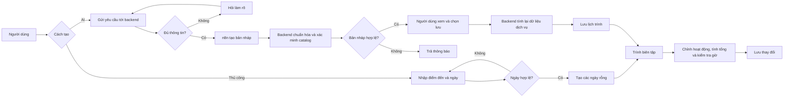
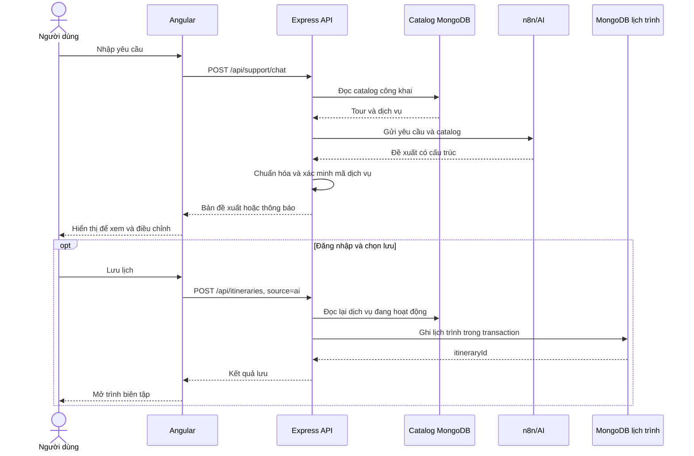
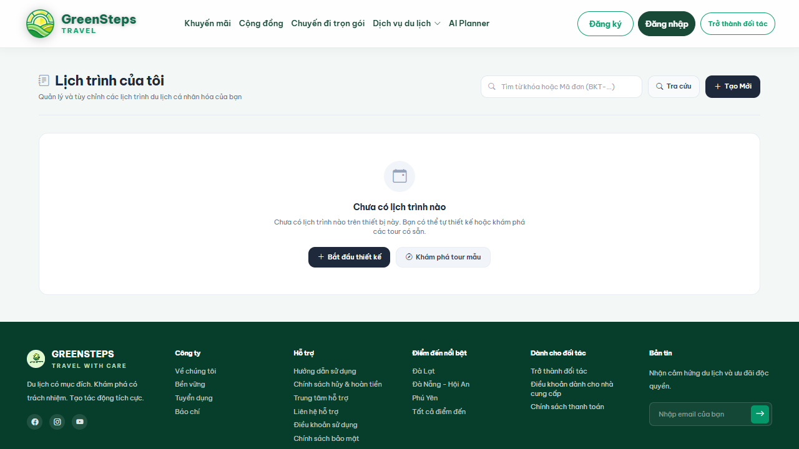
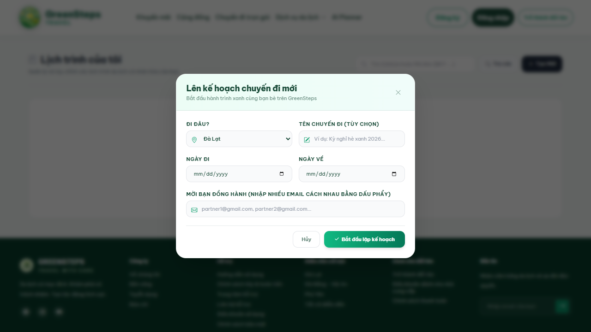
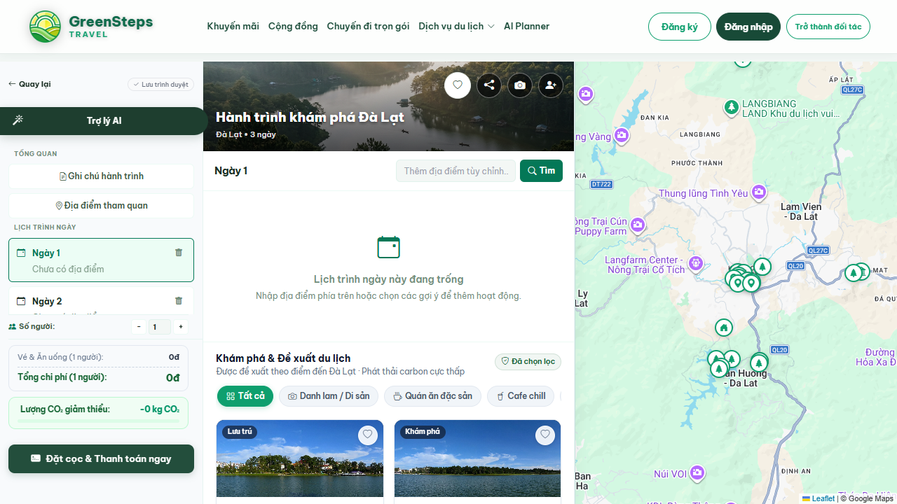
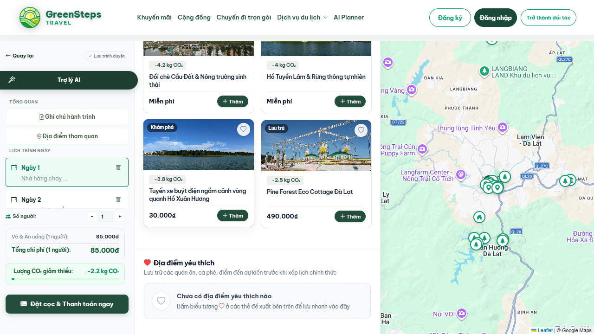
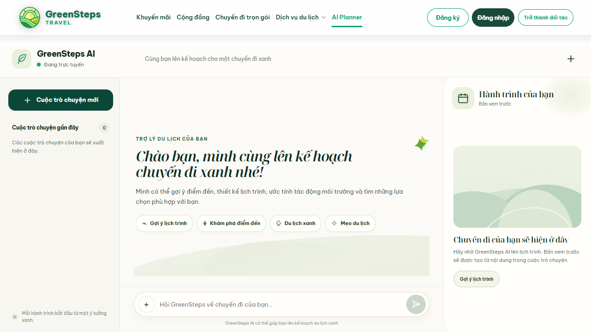

# 3.6. Thiết kế mô-đun lịch trình thông minh

## 3.6.1. Tổng quan mô-đun lịch trình thông minh

Mô-đun lịch trình thông minh của GreenSteps hỗ trợ hai cách khởi tạo hành trình. Người dùng có thể tạo một lịch trình rỗng theo điểm đến và khoảng ngày rồi tự chọn hoạt động trong trình biên tập. Người dùng cũng có thể mô tả chuyến đi bằng ngôn ngữ tự nhiên để trợ lý đề xuất bản nháp theo ngày. Sau khi xem đề xuất, người dùng đăng nhập và chọn lưu để chuyển bản nháp thành lịch trình cá nhân có thể chỉnh sửa. Hai cách này cùng dẫn tới một cấu trúc lịch trình gồm các ngày và các hoạt động có thời điểm bắt đầu.

Về kiến trúc, giao diện được phát triển bằng Angular; các thao tác lưu và đọc lịch trình đi qua REST API Express; dữ liệu được lưu trong MongoDB. Trình biên tập chịu trách nhiệm tương tác trực tiếp như thêm hoạt động, đổi giờ, hiển thị bản đồ, tính chỉ số tức thời và cảnh báo xung đột giờ. Backend giữ vai trò lưu trữ, xác thực dữ liệu AI trước khi lưu và đối chiếu dịch vụ với catalog. Trợ lý AI hoạt động qua endpoint chat của backend, kết nối tới workflow n8n. Vì vậy, một bản nháp AI không tự trở thành booking hoặc dịch vụ đã xác nhận.

Mô-đun liên hệ với catalog tour, dịch vụ, điểm đến, bản đồ, tài khoản và booking. Catalog cung cấp các dịch vụ có thể xác minh; bản đồ hỗ trợ xác định tuyến và thời gian di chuyển; tài khoản xác định nơi lưu lịch trình; booking là bước sau khi người dùng chọn đặt dịch vụ. Thiết kế hiện tại giải quyết việc tập hợp hoạt động vào một nơi, cho phép chỉnh sửa và cảnh báo khoảng thời gian không hợp lý. Việc tự động tối ưu toàn bộ lịch theo ngân sách, giờ mở cửa hoặc mức phát thải vẫn là hướng thiết kế bổ sung, chưa phải cơ chế ràng buộc hoàn chỉnh của ứng dụng.

## 3.6.2. Phân tích dữ liệu đầu vào và đầu ra

Luồng tạo thủ công nhận điểm đến, tên chuyến đi, ngày bắt đầu, ngày kết thúc và email người đồng hành tùy chọn. Frontend kiểm tra ngày kết thúc không đứng trước ngày bắt đầu, tính số ngày theo khoảng ngày và tạo danh sách ngày rỗng. Khi người dùng chưa đăng nhập, bản nháp được lưu trong bộ nhớ trình duyệt; khi đã đăng nhập, dữ liệu được gửi đến API lịch trình. Biểu mẫu tạo thủ công hiện không có các trường ngân sách, sở thích hoặc số người. Số khách được sử dụng ở giai đoạn tính tổng chi phí đặt lịch, không phải điều kiện bắt buộc của biểu mẫu khởi tạo.

Luồng AI nhận một tin nhắn tự do và lịch sử hội thoại có giới hạn. Người dùng có thể nêu điểm đến, thời lượng, ngân sách, yêu cầu hoạt động hoặc ràng buộc trong câu văn; đây là dữ liệu được diễn giải từ ngôn ngữ tự nhiên, không phải một biểu mẫu có trường riêng cho từng tiêu chí. Backend xác định ý định lập lịch; nếu thiếu điểm đến hoặc thời lượng, hệ thống có thể trả về câu hỏi làm rõ. Catalog công khai được chuyển tới workflow để đối chiếu dịch vụ. Bản đề xuất trả về được chuẩn hóa thành điểm đến, tên lịch trình, ngày đi/về nếu có, danh sách ngày, hoạt động, chi phí ước tính và các giả định.

**Bảng 3.6.1. Dữ liệu vào và ra của mô-đun theo mã nguồn hiện tại**

| Dữ liệu | Nguồn/kiểu | Cách sử dụng và giới hạn |
|---|---|---|
| Điểm đến | Biểu mẫu hoặc tin nhắn | Xác định phạm vi dịch vụ và nhãn lịch trình; luồng AI kiểm tra xung đột điểm đến trong phản hồi. |
| Tên chuyến đi | Biểu mẫu hoặc bản nháp AI | Tên hiển thị; hệ thống có tên mặc định khi bỏ trống. |
| Ngày bắt đầu, ngày kết thúc | Biểu mẫu; AI có thể trả về ngày | Luồng thủ công kiểm tra thứ tự ngày; backend chuẩn hóa định dạng ngày AI. |
| Số ngày | Tính từ khoảng ngày hoặc diễn giải tin nhắn | Bản nháp AI được giới hạn tối đa 14 ngày khi chuẩn hóa và lưu. |
| Ngân sách, sở thích | Tin nhắn tự nhiên nếu người dùng nêu | Là ngữ cảnh yêu cầu AI; chưa có bộ tối ưu ngân sách bắt buộc cho toàn lịch. |
| Số khách | Trình biên tập/checkout | Phục vụ tính giá đặt lịch; không phải trường đầu vào của bước tạo lịch rỗng. |
| Hoạt động | Catalog dịch vụ, gợi ý AI hoặc thao tác người dùng | Gồm tên, giờ, chi phí, carbon, loại, tọa độ hoặc mã dịch vụ tùy nguồn. |
| Lịch trình đầu ra | Danh sách ngày và hoạt động | Có thể hiển thị, chỉnh sửa, lưu, đọc lại và dùng làm ngữ cảnh cho bước booking. |
| Chi phí và carbon | Tổng hợp từ hoạt động | Là tổng của các giá trị đang có; hoạt động chưa xác minh từ AI được gán 0 khi lưu qua luồng AI. |

*Diễn giải Bảng 3.6.1:* Các nguồn dữ liệu khác nhau có mức độ xác minh khác nhau. Số 0 trong hoạt động AI chưa đối chiếu catalog biểu thị thiếu giá trị đã xác minh trong luồng lưu, không có nghĩa dịch vụ ngoài đời miễn phí hoặc không phát thải.

## 3.6.3. Thiết kế cơ chế đề xuất lịch trình

Trình biên tập tải dịch vụ theo điểm đến từ backend để tạo danh sách gợi ý động. Dữ liệu dịch vụ được chuyển thành đối tượng giao diện gồm mã, tên, loại, chi phí, carbon, ảnh và tọa độ khi có. Hoạt động đã nằm trong lịch được lọc khỏi tập gợi ý hiển thị. Người dùng chọn hoạt động và tự đặt vào một ngày; hệ thống gợi ý giờ tiếp theo theo thời gian lưu lại tại điểm trước và thời gian di chuyển ước tính. Đây là cơ chế gợi ý theo điều kiện điểm đến và thao tác người dùng, chưa phải thuật toán xếp hạng đa mục tiêu có trọng số được công bố trong mã nguồn.

Đối với đề xuất AI, backend trước hết phân loại yêu cầu để tách ý định lập lịch cá nhân khỏi ý định tìm tour trọn gói. Khi thiếu điểm đến hoặc thời lượng, phản hồi yêu cầu bổ sung thông tin. Khi đủ thông tin và có catalog, backend gửi yêu cầu, phần lịch sử liên quan và dữ liệu công khai sang n8n. Phản hồi được kiểm tra và chuẩn hóa: giới hạn số ngày, số hoạt động/ngày; đưa thời gian về định dạng `HH:mm` hoặc giá trị mặc định; kiểm tra điểm đến trong tên/ngày/hoạt động; loại bỏ đề xuất mâu thuẫn với hoạt động mà người dùng loại trừ; và chỉ coi dịch vụ là đã xác minh khi mã dịch vụ khớp catalog cùng điểm đến, loại hình. Với dịch vụ đã xác minh, tên, giá và carbon được lấy từ catalog thay vì tin vào con số do AI cung cấp. Hoạt động còn lại là gợi ý tham khảo, không được gắn giá GreenSteps đã xác minh.

Mức phù hợp của đề xuất hiện được đánh giá chủ yếu bằng các điều kiện hợp lệ và đối chiếu ngữ nghĩa nêu trên: đúng điểm đến, đúng số ngày người dùng yêu cầu, có hoạt động và có dịch vụ xác minh khi cần tạo lịch từ catalog. Mã nguồn không thể hiện một điểm số tổng hợp để so sánh nhiều phương án lịch trình. Vì thế, báo cáo không gán cho hệ thống thuật toán tối ưu tuyến hoặc mô hình chấm điểm sở thích chưa tồn tại.

## 3.6.4. Thiết kế cơ chế phát hiện và xử lý xung đột

Trình biên tập kiểm tra lần lượt các hoạt động liền kề trong một ngày. Giờ bắt đầu được đổi thành số phút từ đầu ngày. Với hoạt động trước `i−1` và hoạt động sau `i`, điều kiện thời gian hợp lệ là `tᵢ − tᵢ₋₁ ≥ dᵢ₋₁ + mᵢ₋₁,ᵢ`, trong đó `d` là thời lượng lưu lại theo loại hoạt động và `m` là thời gian di chuyển ước tính. Các giá trị lưu lại đang dùng gồm 60 phút cho ăn uống, 45 phút cho quán cà phê, 30 phút cho lưu trú và 90 phút cho tham quan hoặc loại mặc định. Thời gian di chuyển ưu tiên dữ liệu chặng tuyến đã lấy được; nếu thiếu, hệ thống tính từ tọa độ theo Haversine và vận tốc giả định 30 km/giờ cộng 5 phút; nếu thiếu tọa độ, giá trị mặc định là 15 phút.

Khi giờ bắt đầu hoạt động sau bằng hoặc đứng trước hoạt động trước, hoặc chênh lệch giờ nhỏ hơn tổng thời gian lưu lại và di chuyển, giao diện đánh dấu hoạt động và hiển thị lý do. Người dùng có thể sửa một hoạt động hoặc dùng thao tác tự động giãn các mốc giờ liên tiếp. Cơ chế này kiểm tra chuỗi hoạt động đang hiển thị trong một ngày; nó không chứng minh rằng địa điểm còn mở cửa, còn chỗ hay toàn bộ hành trình đã tối ưu.

**Bảng 3.6.2. Quy tắc phát hiện xung đột và trạng thái áp dụng**

| Trường hợp | Quy tắc | Trạng thái |
|---|---|---|
| Trùng hoặc đảo thứ tự giờ | `tᵢ ≤ tᵢ₋₁` | Đã triển khai; cảnh báo trên hoạt động. |
| Không đủ thời gian trải nghiệm và di chuyển | `tᵢ − tᵢ₋₁ < dᵢ₋₁ + mᵢ₋₁,ᵢ` | Đã triển khai; có thao tác tự giãn giờ. |
| Vượt ngân sách người dùng đặt | Tổng chi phí lớn hơn ngân sách đầu vào | Chưa có kiểm tra ràng buộc thống nhất; đề xuất bổ sung. |
| Quá nhiều hoạt động trong ngày | Số hoạt động vượt ngưỡng hợp lý | Chưa có quy tắc nghiệp vụ hoàn chỉnh trong trình biên tập; đề xuất bổ sung. |
| Ngoài giờ mở cửa địa điểm | Thời điểm đến không nằm trong khung giờ hoạt động | Chưa được chứng minh là bước kiểm tra xung đột tự động; đề xuất bổ sung khi dữ liệu giờ mở cửa đủ tin cậy. |

*Diễn giải Bảng 3.6.2:* Nhóm hai quy tắc đầu là hành vi có trong trình biên tập. Ba nhóm sau là yêu cầu thiết kế có thể phát triển tiếp; việc có trường dữ liệu ngân sách hoặc giờ mở cửa ở một nguồn riêng không đồng nghĩa đã có bộ kiểm tra xung đột tương ứng.

## 3.6.5. Thiết kế tính toán chi phí, khoảng cách và yếu tố môi trường

Trong trình biên tập, tổng chi phí hiển thị bằng tổng `cost` của mọi hoạt động thuộc các ngày; tổng carbon hiển thị bằng tổng `carbon`, làm tròn một chữ số thập phân. Thanh tiến độ hiện so sánh tổng chi phí với mốc cố định 8.000.000 đồng và carbon với mốc 80 trong giao diện. Hai mốc này là ngưỡng hiển thị, không phải ngân sách cá nhân hoặc chuẩn môi trường được backend áp đặt. Khi chuyển sang checkout, một phép tính khác tách chi phí tính theo đầu người và chi phí dùng chung: `Tổng đặt lịch = Chi phí theo đầu người × số khách + chi phí dùng chung`. Các hoạt động lưu trú hoặc có cờ chia sẻ thuộc nhóm dùng chung theo logic hiện tại. Giá thanh toán cuối cùng còn phụ thuộc quy tắc booking, phụ phí và voucher ở phân hệ đặt chỗ; vì vậy tổng trên màn hình lịch trình là giá trị tham khảo ở giai đoạn lập kế hoạch.

Khoảng cách giữa hai hoạt động được tính khi có đủ cặp tọa độ. Giao diện có thể yêu cầu tuyến đường lái xe từ dịch vụ OSRM công khai; nếu phản hồi cung cấp chặng đường, độ dài và thời lượng chặng được dùng để hiển thị và kiểm tra khoảng giờ. Khi chưa có tuyến đường, phép Haversine với bán kính Trái Đất 6.371 km cho khoảng cách đường chim bay: `d = 2R·atan2(√a, √(1−a))`, với `a = sin²(Δφ/2) + cosφ₁·cosφ₂·sin²(Δλ/2)`. Thời gian dự phòng từ khoảng cách này chỉ là ước lượng; nếu thiếu tọa độ, giao diện dùng thời gian mặc định và không thể xác định quãng đường chính xác.

Chỉ số carbon hiện được lưu như một thuộc tính của dịch vụ hoặc hoạt động và được cộng tổng; backend cũng cộng lại carbon từ các hoạt động khi ghi lịch trình. Với hoạt động AI có mã dịch vụ hợp lệ, backend lấy carbon từ bản ghi dịch vụ; với hoạt động chưa xác minh, giá trị khi lưu qua luồng AI là 0. Trình biên tập còn có các giá trị carbon mặc định theo loại địa điểm cho một số nguồn không thuộc catalog. Chúng là dữ liệu quy ước của ứng dụng, không phải phép đo phát thải thực tế và không đủ để kết luận tác động môi trường của chuyến đi. Một phương pháp tính phát thải theo phương tiện, cự ly và hệ số có nguồn kiểm chứng là hướng phát triển, chưa phải công thức hiện hành của mô-đun.

## 3.6.6. Thiết kế tích hợp trí tuệ nhân tạo (AI)

Trợ lý trong trang lập kế hoạch sử dụng component chat của Angular. Frontend gửi `message`, `sessionId`, lịch sử hội thoại và trạng thái bản nháp đang trao đổi tới `POST /api/support/chat`. Backend kiểm tra giới hạn dữ liệu, giới hạn tần suất theo người dùng hoặc địa chỉ IP, truy vấn catalog công khai và chuyển yêu cầu tới workflow n8n bằng cấu hình phía máy chủ. Prompt gửi đi nêu rõ ý định `itinerary`, cấu trúc kết quả mong muốn và nguyên tắc chỉ xác minh dịch vụ bằng mã trong catalog. Cấu hình n8n là tích hợp được thể hiện trong mã nguồn; mã nguồn không chứng minh một tên mô hình cụ thể của mọi workflow đang chạy, do đó không gán cố định tên mô hình cho luồng này. Endpoint `/api/ai/chat` là luồng trợ lý cũ phục vụ thao tác trong trình biên tập và có nhánh gọi Gemini khi n8n không trả lời; cần phân biệt với endpoint chat có cấu trúc của trang lập kế hoạch.

Phản hồi có cấu trúc có thể chứa `type=itinerary_proposal`, `itinerary` với tên, điểm đến, ngày, hoạt động và giả định. Backend chuẩn hóa giới hạn tối đa 14 ngày và 12 hoạt động mỗi ngày, đối chiếu mã dịch vụ với catalog và thay dữ liệu AI bằng tên, giá, carbon thật của dịch vụ khi mã hợp lệ. Trường hợp thiếu thông tin quan trọng, hệ thống hỏi làm rõ; trường hợp phản hồi sai điểm đến, loại trừ bị vi phạm, thiếu ngày hoặc không thể xác minh đủ dữ liệu, hệ thống trả phản hồi phù hợp thay vì tự lưu một lịch sai. Frontend cũng kiểm tra mâu thuẫn điểm đến trước khi hiển thị bản nháp.

Việc lưu lịch trình AI là hành động riêng của người dùng. Frontend yêu cầu đăng nhập rồi gửi bản nháp tới `POST /api/itineraries` với nguồn AI. Backend kiểm tra lại người dùng, giới hạn cấu trúc, đọc dịch vụ còn hoạt động và tính lại chi phí/carbon từ catalog trước khi tạo lịch trình nháp. Đây là ranh giới kiểm soát quan trọng: giá trị do AI sinh ra không được coi là dữ liệu thanh toán đáng tin. Khi dịch vụ AI bị lỗi hoặc quá thời gian chờ, API trả lỗi có mã và thông báo; người dùng vẫn có thể duyệt catalog hoặc tự chỉnh lịch trình. Lịch sử chat hiện được quản lý trong bộ nhớ giao diện trong một phiên SPA; việc lưu lâu dài nội dung hội thoại không phải chức năng của luồng này.

**Bảng 3.6.3. Vai trò và luồng dữ liệu giữa các thành phần**

| Thành phần | Dữ liệu nhận | Xử lý chính | Dữ liệu chuyển tiếp |
|---|---|---|---|
| Người dùng | Bản nháp, cảnh báo, chỉ số | Chọn hoạt động, chỉnh giờ, quyết định lưu | Biểu mẫu, tin nhắn và thao tác chỉnh sửa |
| Angular | Đầu vào và phản hồi API | Hiển thị, kiểm tra giờ, tính tổng tức thời | Yêu cầu chat, yêu cầu lưu/đọc lịch |
| Express API | Yêu cầu frontend | Xác thực, chuẩn hóa, đối chiếu catalog, transaction | Dữ liệu công khai tới AI; lịch hợp lệ tới MongoDB |
| Catalog MongoDB | Truy vấn tour/dịch vụ | Cung cấp bản ghi và trạng thái | Mã, tên, giá, carbon và điểm đến |
| Workflow n8n/AI | Yêu cầu và catalog công khai | Tạo đề xuất theo ngôn ngữ tự nhiên | Phản hồi có cấu trúc hoặc thông báo |
| MongoDB lịch trình | Dữ liệu đã kiểm tra | Lưu ngày, hoạt động, chủ sở hữu và trạng thái | Lịch trình khi đọc lại |

*Diễn giải Bảng 3.6.3:* AI tạo phương án tham khảo, còn backend là điểm xác minh dữ liệu nghiệp vụ trước khi lưu. Trình biên tập chịu trách nhiệm cảnh báo thời gian và phản hồi tức thời sau khi người dùng sửa lịch.

## 3.6.7. Thiết kế luồng hoạt động của mô-đun

**Hình 3.6.1. Lưu đồ xử lý tổng thể của mô-đun lịch trình thông minh.** Sơ đồ mô tả hai điểm vào: tạo thủ công và đề xuất AI. Hai nhánh gặp nhau ở trình biên tập sau khi lịch được tạo hoặc lưu. Đường báo lỗi giữ người dùng ở bước nhập hoặc trả thông báo; không có bước đặt chỗ tự động trong luồng AI.

**Hình 3.6.2. Sơ đồ tuần tự tạo lịch trình từ đề xuất AI.** Các lời gọi thể hiện đúng ranh giới giữa giao diện, API, catalog, dịch vụ AI và kho lịch trình. Việc lưu được thực hiện sau khi người dùng quyết định; API đọc lại dịch vụ ở thời điểm lưu để tránh dùng giá do AI tạo ra.

Luồng ngoại lệ gồm ngày kết thúc trước ngày bắt đầu ở nhánh thủ công; thiếu điểm đến hoặc thời lượng ở nhánh AI; phản hồi AI mâu thuẫn với điểm đến; dịch vụ không còn trong catalog; thiếu đăng nhập khi chọn lưu; và mất kết nối. Những tình huống này đều cần phản hồi rõ cho người dùng. Sau khi mở trình biên tập, cảnh báo xung đột giờ là cơ chế hỗ trợ điều chỉnh, không tự bảo đảm lịch trình khả thi theo mọi điều kiện thực địa.

**Hình 3.6.3. Danh sách lịch trình khi trình duyệt chưa có bản nháp.** Màn hình cho phép bắt đầu thiết kế hoặc xem tour mẫu.

**Hình 3.6.4. Biểu mẫu tạo lịch trình thủ công.** Người dùng chọn điểm đến, tên tùy chọn, khoảng ngày và email người đồng hành nếu cần.

**Hình 3.6.5. Trình biên tập lịch trình.** Giao diện kết hợp danh sách ngày, gợi ý địa điểm và bản đồ.

**Hình 3.6.6. Hoạt động và chỉ số chi phí trong bản nháp khách.** Thanh bên hiển thị số người, tổng chi phí và giá trị carbon sau khi thêm một hoạt động.

**Hình 3.6.7. Giao diện AI Planner ở trạng thái chờ yêu cầu.** Hình này minh họa điểm vào của luồng chat, không phải kết quả do AI tạo ra.

*Ghi chú phạm vi:* Các kiểm tra ngân sách cá nhân, mật độ hoạt động và giờ mở cửa trong Bảng 3.6.2 là thiết kế đề xuất. Chúng không xuất hiện như một bước quyết định trong Hình 3.6.1 hoặc Hình 3.6.2 vì chưa có luồng xử lý tương ứng được xác minh trong mã nguồn.
